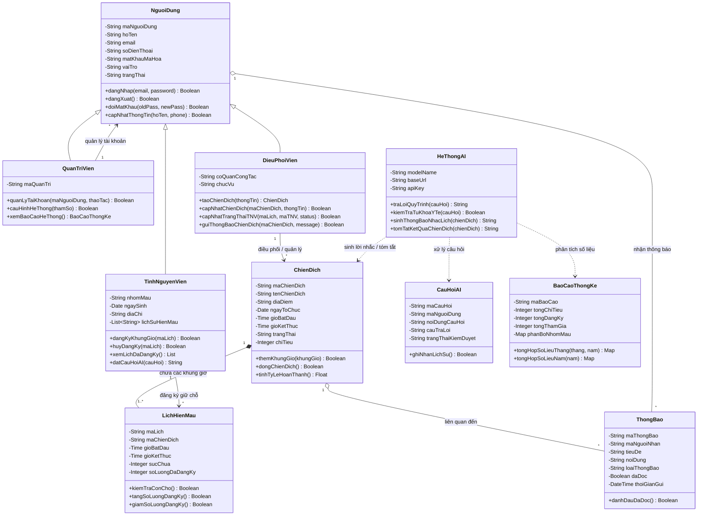

# Kỹ năng Thiết kế Hướng đối tượng & Mô hình lớp (Object-Oriented Design - OOD)

Skill này cung cấp quy trình, cấu trúc và tiêu chuẩn kỹ thuật để thực hiện giai đoạn **Thiết kế chi tiết phần mềm**, phục vụ cho việc lập tài liệu báo cáo chuẩn theo mẫu **`04_GenAI_SoftwareDevelopment_object-oriented-design`** cho dự án phần mềm có tích hợp Trí tuệ Nhân tạo tạo sinh (GenAI).

---

## 1. Mục tiêu & Phạm vi áp dụng

- **Mục tiêu:** Chuyển đổi các Use Case từ Báo cáo 03 thành mô hình hướng đối tượng ở mức thiết kế chi tiết (Low-level Design), bao gồm:
  1. Xây dựng **Sơ đồ lớp tổng quan (Class Diagram)** chuẩn UML, thể hiện đúng các quan hệ: kế thừa (*Inheritance*), kết tập/hợp thành (*Aggregation/Composition*), liên kết (*Association*) và phụ thuộc (*Dependency*).
  2. Lập bảng **Đặc tả chi tiết từng Lớp (Class Specification)**: Định nghĩa tường minh toàn bộ thuộc tính (*Kiểu dữ liệu, Ràng buộc, Giá trị mặc định*) và phương thức (*Tham số đầu vào, Kiểu trả về, Thuật toán/Quy trình xử lý*).
- **Phạm vi:** Áp dụng cho hệ thống **"Mạch Đỏ - Quản lý hiến máu tình nguyện tích hợp AI"** và các đồ án môn học phát triển phần mềm ứng dụng chuyên sâu.

---

## 2. Cấu trúc chuẩn của Báo cáo 04

Báo cáo Thiết kế hướng đối tượng mẫu 04 gồm 2 phần cốt lõi:

```
1. MÔ HÌNH LỚP TỔNG QUAN (CLASS DIAGRAM)
   - Sơ đồ trực quan thể hiện 10 lớp nghiệp vụ và các mối quan hệ giữa chúng
2. ĐẶC TẢ CHI TIẾT CÁC LỚP
   2.1 Lớp NguoiDung (Lớp cơ sở trừu tượng)
   2.2 Lớp TinhNguyenVien (Kế thừa NguoiDung)
   2.3 Lớp QuanTriVien (Kế thừa NguoiDung)
   2.4 Lớp DieuPhoiVien (Kế thừa NguoiDung)
   2.5 Lớp ChienDich (Quản lý chiến dịch hiến máu)
   2.6 Lớp LichHienMau (Khung giờ & Sức chứa / Slot Control)
   2.7 Lớp HeThongAI (Module Trí tuệ nhân tạo)
   2.8 Lớp CauHoiAI (Thực thể truy vấn & kiểm duyệt y tế)
   2.9 Lớp ThongBao (Thông báo & nhắc lịch tự động)
   2.10 Lớp BaoCaoThongKe (Số liệu tổng hợp & tóm tắt)
```

---

## 3. Sơ đồ lớp tổng quan (Class Diagram)

Dưới đây là mô hình lớp chuẩn UML bằng biểu đồ Mermaid thể hiện toàn bộ kiến trúc hướng đối tượng của hệ thống:



---

## 4. Tiêu chuẩn lập Bảng Đặc tả chi tiết Lớp (Template)

Mỗi lớp trong Phần 2 của Báo cáo phải được đặc tả bằng **2 bảng chuẩn**: Bảng Thuộc tính và Bảng Phương thức.

### 4.1 Mẫu Bảng Đặc tả Thuộc tính (Attribute Table)
Mỗi thuộc tính của lớp phải được diễn giải theo cấu trúc 4 mục:

| Thuộc tính: `tenThuocTinh: KieuDuLieu` | Nội dung đặc tả |
| :--- | :--- |
| **Mô tả** | Mục đích sử dụng và ý nghĩa nghiệp vụ của thuộc tính. |
| **Kiểu dữ liệu** | `String`, `Integer`, `Float`, `Boolean`, `Date`, `DateTime`... kèm độ dài tối đa nếu có. |
| **Ràng buộc** | `Not Null` (Bắt buộc), `Unique` (Duy nhất), định dạng (Email/Regex), khoảng giá trị (VD: `ge=1, le=500`). |
| **Giá trị mặc định** | Giá trị tự động gán khi khởi tạo (VD: Tự động sinh `ND0001`, `Chưa cập nhật`, `active`...). |

---

### 4.2 Mẫu Bảng Đặc tả Phương thức (Method Table)
Mỗi phương thức (hàm xử lý) của lớp phải diễn giải theo cấu trúc 4 mục:

| Phương thức: `tenPhuongThuc(thamSo1: Kieu1, ...): KieuTraVe` | Nội dung đặc tả |
| :--- | :--- |
| **Mô tả** | Chức năng của phương thức, mục đích nghiệp vụ đáp ứng Use Case nào. |
| **Tham số đầu vào** | Danh sách tham số, kiểu dữ liệu và ý nghĩa từng tham số. |
| **Kiểu trả về** | Kiểu dữ liệu của kết quả (`Boolean`, `Object`, `List`, `String`...). |
| **Quy trình xử lý** | Các bước thực hiện: kiểm tra điều kiện -> tính toán/truy vấn CSDL -> xử lý nghiệp vụ -> cập nhật trạng thái -> trả về kết quả. |

---

## 5. Danh mục 10 Lớp cốt lõi cần đặc tả trong hệ thống Mạch Đỏ

1. **`2.1. Lớp NguoiDung` (Abstract Base Class):**
   - Thuộc tính: `maNguoiDung`, `hoTen`, `email`, `soDienThoai`, `matKhauMaHoa`, `vaiTro`, `trangThai`.
   - Phương thức: `dangNhap()`, `dangXuat()`, `doiMatKhau()`, `capNhatThongTin()`.
2. **`2.2. Lớp TinhNguyenVien` (Kế thừa `NguoiDung`):**
   - Thuộc tính: `nhomMau`, `ngaySinh`, `diaChi`, `lichSuHienMau`.
   - Phương thức: `dangKyKhungGio()`, `huyDangKy()`, `xemLichDaDangKy()`, `datCauHoiAI()`.
3. **`2.3. Lớp QuanTriVien` (Kế thừa `NguoiDung`):**
   - Thuộc tính: `maQuanTri`.
   - Phương thức: `quanLyTaiKhoan()`, `khoaMoKhoaTaiKhoan()`, `cauHinhHeThong()`, `xemBaoCaoHeThong()`.
4. **`2.4. Lớp DieuPhoiVien` (Kế thừa `NguoiDung`):**
   - Thuộc tính: `coQuanCongTac`, `chucVu`.
   - Phương thức: `taoChienDich()`, `capNhatChienDich()`, `capNhatTrangThaiTNV()`, `guiThongBaoChienDich()`.
5. **`2.5. Lớp ChienDich`:**
   - Thuộc tính: `maChienDich`, `tenChienDich`, `diaDiem`, `ngayToChuc`, `gioBatDau`, `gioKetThuc`, `trangThai`, `chiTieu`.
   - Phương thức: `themKhungGio()`, `capNhatThongTin()`, `dongChienDich()`, `tinhTyLeHoanThanh()`.
6. **`2.6. Lớp LichHienMau` (Khung giờ & Sức chứa):**
   - Thuộc tính: `maLich`, `maChienDich`, `gioBatDau`, `gioKetThuc`, `sucChua` (capacity), `soLuongDaDangKy`.
   - Phương thức: `kiemTraConCho()`, `tangSoLuongDangKy()`, `giamSoLuongDangKy()`.
7. **`2.7. Lớp HeThongAI` (Phân hệ AI Engine):**
   - Thuộc tính: `modelName`, `baseUrl`, `apiKey`, `khoTaiLieuQuyTrinh`.
   - Phương thức: `kiemTraTuKhoaYTe()`, `traLoiQuyTrinh()`, `sinhThongBaoNhacLich()`, `tomTatKetQuaChienDich()`.
8. **`2.8. Lớp CauHoiAI`:**
   - Thuộc tính: `maCauHoi`, `maNguoiDung`, `noiDungCauHoi`, `cauTraLoi`, `trangThaiKiemDuyet`.
   - Phương thức: `ghiNhanLichSu()`, `danhGiaPhanHoi()`.
9. **`2.9. Lớp ThongBao`:**
   - Thuộc tính: `maThongBao`, `maNguoiNhan`, `tieuDe`, `noiDung`, `loaiThongBao`, `daDoc`, `thoiGianGui`.
   - Phương thức: `taoThongBao()`, `danhDauDaDoc()`, `guiThongBao()`.
10. **`2.10. Lớp BaoCaoThongKe`:**
    - Thuộc tính: `maBaoCao`, `tongChiTieu`, `tongDangKy`, `tongThamGia`, `phanBoNhomMau`.
    - Phương thức: `tongHopSoLieuThang()`, `tongHopSoLieuNam()`, `xuatBaoCao()`.

---

## 6. Ràng buộc quan trọng trong Thiết kế Hướng đối tượng

1. **Ranh giới an toàn AI:** Lớp `HeThongAI` không được lưu trữ hoặc xử lý thông tin bệnh án nhạy cảm. Phương thức `kiemTraTuKhoaYTe()` phải hoạt động như một lớp lọc (Guardrail) ngăn chặn câu hỏi sức khỏe cá nhân trước khi gọi mô hình.
2. **Kiểm soát sức chứa đồng thời (Slot Concurrency Control):** Thuộc tính `sucChua` và `soLuongDaDangKy` trong lớp `LichHienMau` phải được quản lý bằng giao dịch để chống xung đột và vượt quá sức chứa.
3. **Tính nhất quán giữa OOD và RDBMS:** Các thuộc tính trong mô hình lớp phải có khả năng ánh xạ trực tiếp sang các bảng CSDL quan hệ trong Báo cáo thiết kế CSDL (Báo cáo 05).

---

## 7. Quy trình 4 bước lập Báo cáo OOD (Báo cáo 04)

1. **Bước 1 — Trích xuất thực thể từ Báo cáo 03:** Lấy danh sách Use Case (UC001 - UC007) và luồng sự kiện để xác định danh sách các Lớp cần thiết.
2. **Bước 2 — Xây dựng Class Diagram:** Sử dụng cú pháp Mermaid để vẽ biểu đồ lớp tổng quan thể hiện đầy đủ thuộc tính, phương thức và các mối quan hệ (Kế thừa, Hợp thành, Kết tập).
3. **Bước 3 — Lập bảng đặc tả chi tiết cho 10 Lớp:** Điền đầy đủ thông tin vào Bảng Thuộc tính và Bảng Phương thức theo đúng khung mẫu tại Mục 4.
4. **Bước 4 — Kiểm tra đối chiếu (Review & Audit):** Đảm bảo tên lớp, tên phương thức và kiểu dữ liệu ăn khớp hoàn toàn với cấu trúc API trong `main.py` và bảng CSDL trong `database/schema.sql`.

