```mermaid
graph TD
    Root["HỆ THỐNG QUẢN LÝ HIẾN MÁU TÍNH NGUYỆN (MẠCH ĐỎ)"]
    
    Root --> M1["1. Quản lý Người dùng & Xác thực"]
    M1 --> M1_1["Đăng ký / Đăng nhập"]
    M1 --> M1_2["Phân quyền vai trò (Admin, Coord, Volunteer)"]
    M1 --> M1_3["Quản lý thông tin cá nhân & Đổi mật khẩu"]

    Root --> M2["2. Quản lý Chiến dịch & Khung giờ"]
    M2 --> M2_1["Tạo / Sửa / Đóng chiến dịch"]
    M2 --> M2_2["Cấu hình khung giờ & Giới hạn sức chứa (Slot Control)"]
    M2 --> M2_3["Tự động khóa slot khi đủ người"]

    Root --> M3["3. Đăng ký & Theo dõi Tham gia"]
    M3 --> M3_1["Tình nguyện viên đăng ký giữ chỗ"]
    M3 --> M3_2["Hủy / Thay đổi lịch đăng ký"]
    M3 --> M3_3["Ghi nhận trạng thái thực tế (Đã đến / Đã hiến)"]

    Root --> M4["4. Dữ liệu Máu & Thống kê"]
    M4 --> M4_1["Lưu trữ dữ liệu nhóm máu (Demo)"]
    M4 --> M4_2["Thống kê số lượng đăng ký & tham gia"]
    M4 --> M4_3["Báo cáo tỷ lệ hoàn thành theo chiến dịch"]

    Root --> M5["5. Phân hệ Trợ lý AI (GenAI)"]
    M5 --> M5_1["Chatbot hỏi đáp quy trình từ tài liệu duyệt"]
    M5 --> M5_2["Cảnh báo & chặn câu hỏi y tế cá nhân"]
    M5 --> M5_3["Sinh thông báo & nhắc lịch chiến dịch"]
    M5 --> M5_4["Tóm tắt kết quả & thống kê chiến dịch"]
```

# Thu Thập và Làm Rõ Yêu Cầu Ứng Dụng (Requirements Elicitation & Q&A)

Skill này cung cấp quy trình và tiêu chuẩn để thực hiện giai đoạn **Khảo sát, Thu thập & Làm rõ Yêu cầu (KT1)**, đặc biệt phục vụ cho việc tạo ra tài liệu báo cáo chuẩn theo mẫu **`02_GenAI_SoftwareDevelopment_requirements-qa`** cho các dự án phần mềm có tích hợp Trí tuệ Nhân tạo tạo sinh (GenAI).

---

## 1. Mục tiêu & Phạm vi áp dụng

- **Mục tiêu:** Chuyển đổi bài toán thực tế (Problem Statement) thành tài liệu đặc tả yêu cầu có cấu trúc, bao gồm:
  1. Bộ câu hỏi phỏng vấn làm rõ yêu cầu đa chiều (Stakeholder Elicitation Q&A).
  2. Bóc tách danh mục Yêu cầu chức năng (Functional Requirements - FR).
  3. Bóc tách danh mục Yêu cầu phi chức năng (Non-Functional Requirements - NFR) đặc thù cho hệ thống tích hợp GenAI (An toàn y tế, bảo mật dữ liệu, an toàn prompt).
  4. Sơ đồ phân cấp chức năng của ứng dụng (Functional Decomposition Diagram).
- **Phạm vi:** Áp dụng cho hệ thống "Mạch Đỏ - Quản lý hiến máu tình nguyện tích hợp AI" và các đồ án môn học phát triển phần mềm ứng dụng chuyên sâu.

---

## 2. Cấu trúc chuẩn của Báo cáo 02

Một báo cáo làm rõ yêu cầu chuẩn (mẫu file `02_GenAI_SoftwareDevelopment_requirements-qa.docx`) gồm 3 phần bắt buộc:

### Phần 1: Bảng câu hỏi thu thập & làm rõ yêu cầu (Q&A Table)
Bảng gồm 4 cột: `STT | Câu hỏi (Questions) | Trả lời (Answers) | Ghi chú (Xác định chức năng)`.
Bắt buộc phải bao quát đủ **4 nhóm trụ cột nghiệp vụ**:

1. **Nhóm Quản lý tài khoản & Phân quyền (RBAC):**
   - Đăng ký, đăng nhập qua Email/SĐT.
   - Cơ chế phân quyền: Quản trị viên (Admin), Điều phối viên (Coordinator), Tình nguyện viên/Người hiến máu (Volunteer/Donor).
   - Quyền hạn truy cập dữ liệu của từng vai trò (Volunteer chỉ xem dữ liệu của mình).
2. **Nhóm Quản lý chiến dịch & Điểm hiến:**
   - Tạo, sửa, đóng/mở chiến dịch, thời gian, địa điểm.
   - Kiểm soát sức chứa theo khung giờ (**Time-slot Slot Control**) để tránh quá tải tại điểm hiến.
3. **Nhóm Quản lý đăng ký, Kết quả & Dữ liệu máu:**
   - Tình nguyện viên chủ động đăng ký giữ chỗ theo khung giờ.
   - Hủy/đổi lịch đăng ký trước thời hạn quy định.
   - Ghi nhận trạng thái tham gia thực tế (`Đã đăng ký` -> `Đã đến` -> `Đã hiến` / `Hoãn do sức khỏe` / `Vắng mặt`).
   - Quản lý dữ liệu nhóm máu (dưới dạng dữ liệu demo: A, B, AB, O, Rh+/-).
   - Thống kê tỷ lệ tham gia, số lượng người đăng ký và phân bổ nguồn máu.
4. **Nhóm Tích hợp GenAI & Ranh giới an toàn:**
   - Trợ lý AI hỏi đáp quy trình hiến máu từ **tài liệu nội bộ được duyệt**.
   - Phân tích & tóm tắt số liệu kết quả chiến dịch hiến máu.
   - Sinh nội dung thông báo / nhắc lịch chiến dịch.
   - **Ranh giới an toàn bắt buộc:** AI tuyệt đối không tư vấn y khoa cá nhân, chuyển hướng người dùng gặp nhân viên y tế trực tiếp.

---

### Phần 2: Danh mục Yêu cầu Chức năng (FR) & Phi chức năng (NFR)

#### 2.1. Yêu cầu chức năng (Functional Requirements - FR)
Trình bày theo phân hệ rõ ràng:
- **Phân hệ Người dùng & Xác thực:**
  - Đăng ký, đăng nhập an toàn, mã hóa mật khẩu (PBKDF2/Bcrypt).
  - Phân quyền theo vai trò (Role-Based Access Control).
- **Phân hệ Chiến dịch & Điều phối lịch:**
  - Quản lý danh sách chiến dịch, điểm hiến, thời gian.
  - Phân chia khung giờ linh hoạt, giới hạn sức chứa (`capacity`) và khóa tự động khi đủ chỗ.
  - Cập nhật trạng thái người tham gia sau khi sàng lọc y tế.
- **Phân hệ Quản lý dữ liệu & Báo cáo:**
  - Quản lý hồ sơ người hiến và nhóm máu mô phỏng.
  - Dashboard thống kê trực quan (tổng lượt đăng ký, tỷ lệ hoàn thành, phân bổ nhóm máu).
- **Phân hệ Tích hợp Trí tuệ Nhân tạo (GenAI):**
  - **Tự động sinh thông báo/nhắc lịch:** Tạo thông báo thân thiện từ thông tin chiến dịch.
  - **Chatbot tra cứu quy trình (RAG-like):** Trích xuất từ tài liệu đã được duyệt, từ chối trả lời ngoài phạm vi.
  - **Tóm tắt báo cáo chiến dịch:** Tổng hợp số liệu định lượng (chỉ tiêu, thực tế, tỷ lệ) thành báo cáo ngắn gọn.

#### 2.2. Yêu cầu phi chức năng (Non-Functional Requirements - NFR) đặc thù GenAI
- **Kiểm soát An toàn Y tế (Medical Safety & Disclaimer):** Bắt buộc hiển thị cảnh báo: *"AI chỉ cung cấp thông tin quy trình chung, không tư vấn hay chẩn đoán y khoa cá nhân"*. Backend phải có lớp lọc từ khóa nhạy cảm về bệnh án/thuốc để chặn kịp thời.
- **Bảo vệ dữ liệu cá nhân (PII Protection):** Không đưa dữ liệu định danh nhạy cảm (CCCD, hồ sơ bệnh án riêng tư) vào prompt gửi tới nhà cung cấp AI.
- **An toàn Prompt (Prompt Safety):** Chống tấn công vượt rào (Prompt Injection, Jailbreak).
- **Hiệu năng & Khả dụng (Performance):** 
  - Giao diện web tải dưới 3 giây.
  - Thao tác API thông thường xử lý dưới 1 giây.
  - Phản hồi từ mô hình AI dưới 5 giây; có cơ chế mẫu câu dự phòng (Fallback) khi mất kết nối mạng hoặc không có API key.

---

### Phần 3: Sơ đồ phân cấp chức năng (Functional Decomposition Diagram)

Sơ đồ phân rã theo dạng cấu trúc cây (Tree structure) hoặc biểu đồ phân cấp:

---

## 3. Quy trình từng bước lập Báo cáo 02 (Step-by-step Execution)

Khi nhận yêu cầu tạo mới hoặc hoàn thiện Báo cáo `02_GenAI_SoftwareDevelopment_requirements-qa`, hãy thực hiện lần lượt các bước sau:

### Bước 1: Thu thập thông tin đầu vào
1. Đọc kỹ **Mô tả bài toán (Problem Statement)** và **Mục tiêu của đơn vị tài trợ/khách hàng**.
2. Xác định các bên liên quan (Stakeholders): Ban quản trị, Đơn vị y tế/Điều phối viên, Người hiến máu/Tình nguyện viên.

### Bước 2: Thiết lập bảng 16+ câu hỏi phỏng vấn (Q&A Matrix)
- Đặt câu hỏi xuất phát từ nhu cầu thực tế: *"Làm sao tránh trùng giờ?"*, *"Làm sao biết người hiến có đến không?"*, *"AI trả lời sai bệnh lý thì sao?"*.
- Câu trả lời phải khẳng định rõ giải pháp kỹ thuật/nghiệp vụ.
- Cột "Ghi chú" phải ghi rõ nhóm chức năng được ánh xạ (ví dụ: `Xác định chức năng kiểm soát số lượng (quản lý chiến dịch và địa điểm)`).

### Bước 3: Phân loại & Viết đặc tả FR và NFR
- **FR:** Trình bày gạch đầu dòng rõ ràng, phân nhóm theo các phân hệ trong sơ đồ phân cấp.
- **NFR:** Đặc biệt nhấn mạnh yếu tố **Kiểm soát ranh giới y khoa cá nhân** và **Fallback không phụ thuộc AI API**.

### Bước 4: Lập sơ đồ phân cấp chức năng
- Vẽ sơ đồ phân cấp dạng danh sách có thụt lề hoặc Mermaid diagram, đảm bảo bao phủ 100% các yêu cầu chức năng đã liệt kê ở Bước 3.

### Bước 5: Kiểm tra chất lượng (Quality Checklist)
- [x] Đã đủ 3 vai trò: Admin, Điều phối viên (Coordinator), Tình nguyện viên (Volunteer).
- [x] Đã có cơ chế kiểm soát số lượng theo khung giờ (Slot capacity control).
- [x] Đã có tuyên bố miễn trừ trách nhiệm y tế (Medical Disclaimer) và cơ chế chặn câu hỏi sức khỏe riêng tư.
- [x] Dữ liệu nhóm máu được định danh rõ là mức độ thử nghiệm/demo, không thay thế xét nghiệm y tế thật.
- [x] Có cơ chế hoạt động offline / mẫu câu dự phòng khi không có khóa API AI.

---

## 2. Cấu trúc chuẩn của Báo cáo 02

Một báo cáo làm rõ yêu cầu chuẩn (mẫu file `02_GenAI_SoftwareDevelopment_requirements-qa.docx`) gồm 3 phần bắt buộc:

### Phần 1: Bảng câu hỏi thu thập & làm rõ yêu cầu (Q&A Table)
Bảng gồm 4 cột: `STT | Câu hỏi (Questions) | Trả lời (Answers) | Ghi chú (Xác định chức năng)`.
Bắt buộc phải bao quát đủ **4 nhóm trụ cột nghiệp vụ**:

1. **Nhóm Quản lý tài khoản & Phân quyền (RBAC):**
   - Đăng ký, đăng nhập qua Email/SĐT.
   - Cơ chế phân quyền: Quản trị viên (Admin), Điều phối viên (Coordinator), Tình nguyện viên/Người hiến máu (Volunteer/Donor).
   - Quyền hạn truy cập dữ liệu của từng vai trò (Volunteer chỉ xem dữ liệu của mình).
2. **Nhóm Quản lý chiến dịch & Điểm hiến:**
   - Tạo, sửa, đóng/mở chiến dịch, thời gian, địa điểm.
   - Kiểm soát sức chứa theo khung giờ (**Time-slot Slot Control**) để tránh quá tải tại điểm hiến.
3. **Nhóm Quản lý đăng ký, Kết quả & Dữ liệu máu:**
   - Tình nguyện viên chủ động đăng ký giữ chỗ theo khung giờ.
   - Hủy/đổi lịch đăng ký trước thời hạn quy định.
   - Ghi nhận trạng thái tham gia thực tế (`Đã đăng ký` -> `Đã đến` -> `Đã hiến` / `Hoãn do sức khỏe` / `Vắng mặt`).
   - Quản lý dữ liệu nhóm máu (dưới dạng dữ liệu demo: A, B, AB, O, Rh+/-).
   - Thống kê tỷ lệ tham gia, số lượng người đăng ký và phân bổ nguồn máu.
4. **Nhóm Tích hợp GenAI & Ranh giới an toàn:**
   - Trợ lý AI hỏi đáp quy trình hiến máu từ **tài liệu nội bộ được duyệt**.
   - Phân tích & tóm tắt số liệu kết quả chiến dịch hiến máu.
   - Sinh nội dung thông báo / nhắc lịch chiến dịch.
   - **Ranh giới an toàn bắt buộc:** AI tuyệt đối không tư vấn y khoa cá nhân, chuyển hướng người dùng gặp nhân viên y tế trực tiếp.

---

### Phần 2: Danh mục Yêu cầu Chức năng (FR) & Phi chức năng (NFR)

#### 2.1. Yêu cầu chức năng (Functional Requirements - FR)
Trình bày theo phân hệ rõ ràng:
- **Phân hệ Người dùng & Xác thực:**
  - Đăng ký, đăng nhập an toàn, mã hóa mật khẩu (PBKDF2/Bcrypt).
  - Phân quyền theo vai trò (Role-Based Access Control).
- **Phân hệ Chiến dịch & Điều phối lịch:**
  - Quản lý danh sách chiến dịch, điểm hiến, thời gian.
  - Phân chia khung giờ linh hoạt, giới hạn sức chứa (`capacity`) và khóa tự động khi đủ chỗ.
  - Cập nhật trạng thái người tham gia sau khi sàng lọc y tế.
- **Phân hệ Quản lý dữ liệu & Báo cáo:**
  - Quản lý hồ sơ người hiến và nhóm máu mô phỏng.
  - Dashboard thống kê trực quan (tổng lượt đăng ký, tỷ lệ hoàn thành, phân bổ nhóm máu).
- **Phân hệ Tích hợp Trí tuệ Nhân tạo (GenAI):**
  - **Tự động sinh thông báo/nhắc lịch:** Tạo thông báo thân thiện từ thông tin chiến dịch.
  - **Chatbot tra cứu quy trình (RAG-like):** Trích xuất từ tài liệu đã được duyệt, từ chối trả lời ngoài phạm vi.
  - **Tóm tắt báo cáo chiến dịch:** Tổng hợp số liệu định lượng (chỉ tiêu, thực tế, tỷ lệ) thành báo cáo ngắn gọn.

#### 2.2. Yêu cầu phi chức năng (Non-Functional Requirements - NFR) đặc thù GenAI
- **Kiểm soát An toàn Y tế (Medical Safety & Disclaimer):** Bắt buộc hiển thị cảnh báo: *"AI chỉ cung cấp thông tin quy trình chung, không tư vấn hay chẩn đoán y khoa cá nhân"*. Backend phải có lớp lọc từ khóa nhạy cảm về bệnh án/thuốc để chặn kịp thời.
- **Bảo vệ dữ liệu cá nhân (PII Protection):** Không đưa dữ liệu định danh nhạy cảm (CCCD, hồ sơ bệnh án riêng tư) vào prompt gửi tới nhà cung cấp AI.
- **An toàn Prompt (Prompt Safety):** Chống tấn công vượt rào (Prompt Injection, Jailbreak).
- **Hiệu năng & Khả dụng (Performance):** 
  - Giao diện web tải dưới 3 giây.
  - Thao tác API thông thường xử lý dưới 1 giây.
  - Phản hồi từ mô hình AI dưới 5 giây; có cơ chế mẫu câu dự phòng (Fallback) khi mất kết nối mạng hoặc không có API key.

---

### Phần 3: Sơ đồ phân cấp chức năng (Functional Decomposition Diagram)

Sơ đồ phân rã theo dạng cấu trúc cây (Tree structure) hoặc biểu đồ phân cấp:

---

## 3. Quy trình từng bước lập Báo cáo 02 (Step-by-step Execution)

Khi nhận yêu cầu tạo mới hoặc hoàn thiện Báo cáo `02_GenAI_SoftwareDevelopment_requirements-qa`, hãy thực hiện lần lượt các bước sau:

### Bước 1: Thu thập thông tin đầu vào
1. Đọc kỹ **Mô tả bài toán (Problem Statement)** và **Mục tiêu của đơn vị tài trợ/khách hàng**.
2. Xác định các bên liên quan (Stakeholders): Ban quản trị, Đơn vị y tế/Điều phối viên, Người hiến máu/Tình nguyện viên.

### Bước 2: Thiết lập bảng 16+ câu hỏi phỏng vấn (Q&A Matrix)
- Đặt câu hỏi xuất phát từ nhu cầu thực tế: *"Làm sao tránh trùng giờ?"*, *"Làm sao biết người hiến có đến không?"*, *"AI trả lời sai bệnh lý thì sao?"*.
- Câu trả lời phải khẳng định rõ giải pháp kỹ thuật/nghiệp vụ.
- Cột "Ghi chú" phải ghi rõ nhóm chức năng được ánh xạ (ví dụ: `Xác định chức năng kiểm soát số lượng (quản lý chiến dịch và địa điểm)`).

### Bước 3: Phân loại & Viết đặc tả FR và NFR
- **FR:** Trình bày gạch đầu dòng rõ ràng, phân nhóm theo các phân hệ trong sơ đồ phân cấp.
- **NFR:** Đặc biệt nhấn mạnh yếu tố **Kiểm soát ranh giới y khoa cá nhân** và **Fallback không phụ thuộc AI API**.

### Bước 4: Lập sơ đồ phân cấp chức năng
- Vẽ sơ đồ phân cấp dạng danh sách có thụt lề hoặc Mermaid diagram, đảm bảo bao phủ 100% các yêu cầu chức năng đã liệt kê ở Bước 3.

### Bước 5: Kiểm tra chất lượng (Quality Checklist)
- [x] Đã đủ 3 vai trò: Admin, Điều phối viên (Coordinator), Tình nguyện viên (Volunteer).
- [x] Đã có cơ chế kiểm soát số lượng theo khung giờ (Slot capacity control).
- [x] Đã có tuyên bố miễn trừ trách nhiệm y tế (Medical Disclaimer) và cơ chế chặn câu hỏi sức khỏe riêng tư.
- [x] Dữ liệu nhóm máu được định danh rõ là mức độ thử nghiệm/demo, không thay thế xét nghiệm y tế thật.
- [x] Có cơ chế hoạt động offline / mẫu câu dự phòng khi không có khóa API AI.

