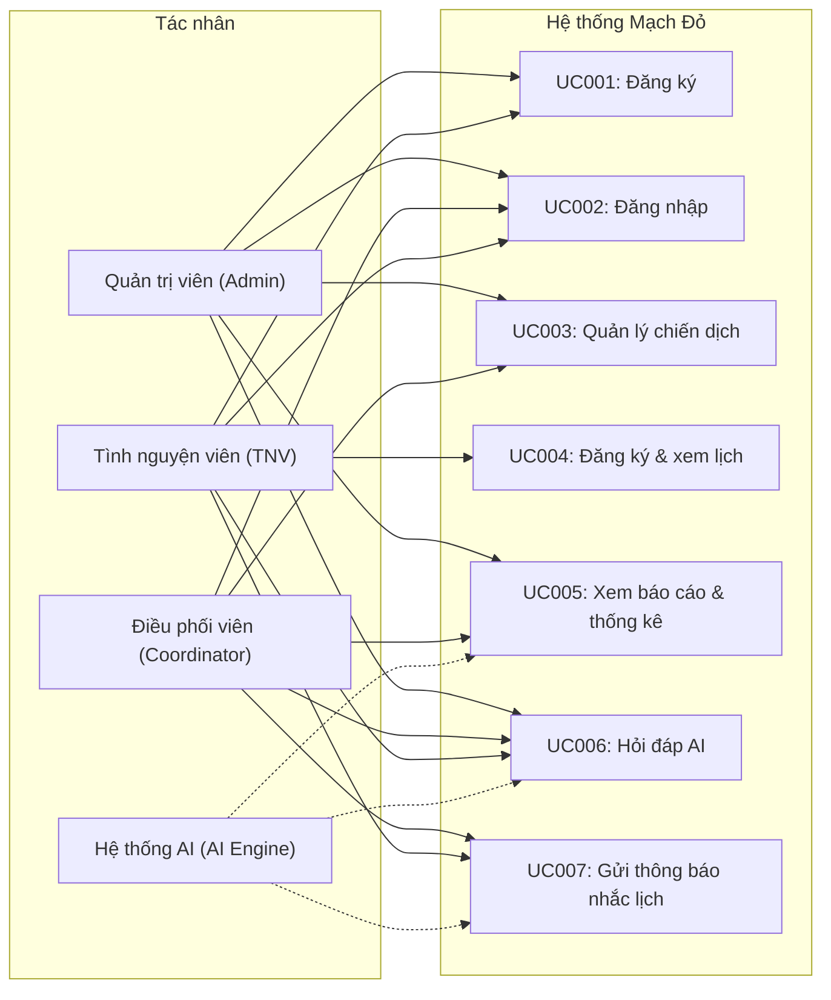
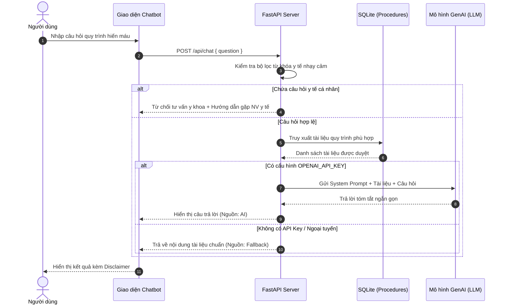

# Kỹ năng Đặc tả Yêu cầu Phần mềm (Software Requirements Specification - SRS)

Skill này cung cấp quy trình, cấu trúc và tiêu chuẩn kỹ thuật để lập tài liệu **Đặc tả Yêu cầu Ứng dụng (SRS - Software Requirements Specification)** theo đúng mẫu báo cáo số **`03_GenAI_SoftwareDevelopment_requirements-specification`** cho dự án phần mềm có tích hợp Trí tuệ Nhân tạo tạo sinh (GenAI).

---

## 1. Mục tiêu & Phạm vi áp dụng

- **Mục tiêu:** Chuyển đổi các yêu cầu đã làm rõ từ Báo cáo 02 thành tài liệu đặc tả kỹ thuật chi tiết mức Use Case (SRS tiêu chuẩn IEEE 830/RUP), phục vụ làm căn cứ trực tiếp cho:
  1. Đội ngũ phát triển (Developers) thiết kế CSDL, xây dựng API và lập trình giao diện.
  2. Đội ngũ kiểm thử (QA/QC) thiết kế test scenario và test case.
  3. Đơn vị chủ quản và khách hàng nghiệm thu sản phẩm.
- **Phạm vi áp dụng:** Hệ thống **"Mạch Đỏ - Quản lý hiến máu tình nguyện tích hợp AI"** và các đồ án chuyên sâu tương tự.

---

## 2. Cấu trúc chuẩn của Báo cáo SRS (Báo cáo 03)

Báo cáo đặc tả yêu cầu mẫu 03 gồm 4 phần chính bắt buộc:

```
1. GIỚI THIỆU CHUNG
   1.1 Mục đích
   1.2 Phạm vi
   1.3 Các định nghĩa, thuật ngữ, từ viết tắt
   1.4 Tài liệu tham khảo
2. MÔ TẢ TỔNG QUAN ỨNG DỤNG
   2.1 Mô hình Use Case tổng quát (Sơ đồ tổng quan)
   2.2 Danh sách các tác nhân và mô tả
   2.3 Danh sách Use Case và mô tả tóm tắt (UC001 - UC007)
   2.4 Các điều kiện phụ thuộc
3. ĐẶC TẢ CHI TIẾT CÁC USE CASE (UC001 - UC007)
   - Mỗi Use Case gồm: Mục đích, Mô tả, Tác nhân, Điều kiện trước/sau, Basic Flows, Alternative Flows, Biểu đồ
4. CÁC THÔNG TIN HỖ TRỢ KHÁC
   4.1 Công nghệ và công cụ sử dụng
   4.2 Sơ đồ luồng hỗ trợ AI
```

---

## 3. Chi tiết nội dung các phần trong Báo cáo

### Phần 1: Giới thiệu chung
- **1.1 Mục đích:** Nêu rõ tài liệu SRS định hình chi tiết kiến trúc giải pháp, nghiệp vụ và ràng buộc kỹ thuật của hệ thống.
- **1.2 Phạm vi:**
  - *Đơn vị áp dụng:* Đơn vị tổ chức hiến máu (Bệnh viện, Hội Chữ thập đỏ, Trường Đại học).
  - *Đối tượng phục vụ:* Người hiến máu/TNV, Điều phối viên, Quản trị viên.
  - *Các phân hệ:* Web Portal Quản trị & Điều phối, Ứng dụng/Web Người hiến máu, Phân hệ AI Engine (Trợ lý quy trình, Sinh thông báo, Tóm tắt chiến dịch).
- **1.3 Thuật ngữ & Viết tắt:** AI, QA, TNV, Coord, Admin, RBAC, PII, Time-slot...
- **1.4 Tài liệu tham khảo:** Thông tư 26/2013/TT-BYT (Quy định hoạt động hiến máu), các quy định về an toàn y tế và dữ liệu cá nhân.

---

### Phần 2: Mô tả tổng quan ứng dụng
- **2.1 Mô hình Use Case tổng quát:** Biểu diễn trực quan bằng Mermaid Diagram:



- **2.2 Danh sách tác nhân (Actors):**
  1. **Tình nguyện viên (TNV):** Đăng ký tài khoản, xem chiến dịch, đăng ký khung giờ, nhận nhắc lịch, tương tác với AI Chatbot.
  2. **Điều phối viên (Coord):** Khởi tạo/cập nhật chiến dịch, quản lý điểm hiến, cập nhật trạng thái tham gia, xem thống kê.
  3. **Quản trị viên (Admin):** Quản lý kỹ thuật, cấu hình tài khoản, phân quyền (RBAC), xem báo cáo tổng thể.
  4. **Hệ thống AI (AI Engine):** Tác nhân hỗ trợ tự động: vận hành Chatbot hỏi đáp theo tài liệu duyệt, sinh nội dung thông báo và tóm tắt số liệu.
- **2.3 Danh sách Use Case tổng hợp:** Bảng mã UC, Tên Use Case và mô tả tóm tắt (từ UC001 đến UC007).
- **2.4 Điều kiện phụ thuộc:** Môi trường mạng, CSDL, dịch vụ AI (có cơ chế hoạt động offline/mẫu câu fallback khi mất kết nối).

---

### Phần 3: Mẫu chuẩn đặc tả chi tiết Use Case (Template)

Mỗi Use Case phải tuân thủ nghiêm ngặt cấu trúc chuẩn sau:

```markdown
### UCxxx_Tên_Use_Case
- **Mục đích:** Mô tả ngắn gọn kết quả cần đạt được.
- **Mô tả:** Diễn giải chi tiết chức năng và giá trị mang lại cho người dùng.
- **Tác nhân:** Tác nhân chính (khởi tạo luồng), Tác nhân phụ (hệ thống/dịch vụ).
- **Điều kiện trước (Pre-conditions):** Trạng thái hệ thống/người dùng trước khi thực hiện.
- **Điều kiện sau (Post-conditions):** Kết quả dữ liệu/trạng thái sau khi hoàn tất thành công.
- **Luồng sự kiện chính (Basic Flows):**
  1. Người dùng thực hiện thao tác...
  2. Hệ thống kiểm tra/xử lý...
  3. Hệ thống trả về kết quả/giao diện...
- **Luồng sự kiện phụ / Ngoại lệ (Alternative Flows):**
  - A1: [Tên tình huống lỗi/rẽ nhánh 1]
    1. Hệ thống phát hiện...
    2. Hệ thống thông báo... và hướng xử lý.
  - A2: [Tên tình huống lỗi/rẽ nhánh 2]...
- **Biểu đồ minh họa:** Biểu đồ Sequence hoặc Activity bằng Mermaid.
```

---

### Danh mục 7 Use Case chi tiết của hệ thống Mạch Đỏ:

#### 1. `UC001_Đăng ký`
- Tác nhân: Người dùng mới (Volunteer).
- Luồng chính: Nhập họ tên, email, mật khẩu -> Hệ thống validate định dạng và kiểm tra trùng email -> Lưu CSDL với vai trò `volunteer` -> Thông báo thành công và chuyển sang Đăng nhập.
- Luồng phụ: A1: Thiếu thông tin hoặc sai format; A2: Email đã tồn tại; A3: Mật khẩu xác nhận không khớp.

#### 2. `UC002_Đăng nhập`
- Tác nhân: Admin, Coordinator, Volunteer.
- Luồng chính: Nhập email/mật khẩu -> Hệ thống băm PBKDF2 và đối chiếu -> Cấp phiên đăng nhập (Token) và điều hướng về trang chủ tương ứng với vai trò.
- Luồng phụ: A1: Sai thông tin đăng nhập; A2: Tài khoản bị khóa (`status = locked`); A3: Phiên hết hạn/đăng xuất.

#### 3. `UC003_Quản lý chiến dịch`
- Tác nhân: Admin, Coordinator.
- Luồng chính: Xem danh sách -> Bấm tạo mới/sửa -> Nhập tên chiến dịch, ngày, địa điểm, thời gian, danh sách khung giờ và chỉ tiêu sức chứa -> Hệ thống lưu CSDL.
- Luồng phụ: A1: Ngày chiến dịch ở quá khứ; A2: Khung giờ đã có người đăng ký không được đổi ngày/giờ; A3: Xóa chiến dịch bị từ chối nếu đã có lượt đăng ký liên kết.

#### 4. `UC004_Đăng ký & xem lịch`
- Tác nhân: Tình nguyện viên (Volunteer).
- Luồng chính: Xem danh sách chiến dịch đang mở -> Chọn khung giờ còn chỗ -> Bấm xác nhận giữ chỗ -> Hệ thống khóa giao dịch (`BEGIN IMMEDIATE`), kiểm tra sức chứa (`current < capacity`) và kiểm tra không trùng lịch -> Ghi nhận lượt hẹn (`Đã đăng ký`).
- Luồng phụ: A1: Khung giờ vừa hết chỗ (Full capacity); A2: Tình nguyện viên đã đăng ký khung giờ trùng hoặc đã đăng ký chiến dịch này; A3: Tình nguyện viên tự hủy lịch trước hạn.

#### 5. `UC005_Xem báo cáo & thống kê`
- Tác nhân: Admin, Coordinator.
- Luồng chính: Truy cập Dashboard / Báo cáo -> Hệ thống tổng hợp số liệu: tổng chiến dịch, tổng lượt đăng ký, số lượt tham gia thực tế, phân bổ nhóm máu mẫu -> Gọi AI tóm tắt phân tích hoặc dùng mẫu thống kê dự phòng.
- Luồng phụ: A1: Khoảng thời gian không có chiến dịch nào; A2: Lỗi kết nối dịch vụ AI ngoài -> tự động chuyển sang mẫu báo cáo dự phòng.

#### 6. `UC006_Hỏi đáp AI`
- Tác nhân: Người dùng (Volunteer, Admin, Coordinator).
- Luồng chính: Người dùng nhập câu hỏi -> **Backend quét từ khóa y tế nhạy cảm** (bệnh lý, thuốc, chẩn đoán cá nhân) -> Nếu bình thường: truy xuất tài liệu quy trình đã được duyệt -> Gửi prompt chuẩn tới AI -> Hiển thị câu trả lời kèm nguồn và cảnh báo miễn trừ trách nhiệm y tế.
- Luồng phụ: 
  - **A1: Phát hiện câu hỏi y tế cá nhân:** Hệ thống chặn ngay lập tức, hiển thị từ chối: *"Mình không thể đánh giá sức khỏe hoặc điều kiện hiến máu cá nhân. Nhân viên y tế sẽ tư vấn trực tiếp tại điểm hiến."*
  - A2: Không tìm thấy tài liệu phù hợp trong kho quy trình đã duyệt -> Hướng dẫn liên hệ trực tiếp điều phối viên.
  - A3: Mất mạng / Không có API key AI -> Trả về trực tiếp nội dung trích xuất từ tài liệu quy trình (Fallback).

#### 7. `UC007_Gửi thông báo nhắc lịch`
- Tác nhân: Hệ thống (tự động) / Coordinator (kích hoạt).
- Luồng chính: Quét các lượt hẹn sắp diễn ra trong 24-48 giờ tới -> Tự động sinh nội dung nhắc lịch thân thiện (thời gian, địa điểm, lưu ý trước khi hiến) -> Lưu vào bảng `notifications` nội bộ của người dùng -> Người dùng mở hộp thư xem thông báo.
- Luồng phụ: A1: Không có lượt hẹn nào sắp tới; A2: Lỗi tạo nội dung AI -> Sử dụng mẫu thông báo mặc định.

---

### Phần 4: Thông tin hỗ trợ kỹ thuật khác
- **Công nghệ nền tảng:** FastAPI (Python), SQLite (WAL mode, Foreign keys), HTML5/CSS/Vanilla JS Single Page App.
- **Sơ đồ luồng hỗ trợ AI (GenAI Flow):**



---

## 4. Quy trình 4 bước tạo Báo cáo SRS (Báo cáo 03)

Khi cần soạn thảo hoặc xuất file Báo cáo SRS số 03:
1. **Bước 1: Tiếp nhận đầu vào từ Báo cáo 02:**
   - Lấy danh mục chức năng (FR) đã làm rõ ở Báo cáo 02 để ánh xạ thành các Use Case (UC001 đến UC007).
2. **Bước 2: Xây dựng Mô hình Use Case & Danh sách tác nhân:**
   - Xác định rõ vai trò và phạm vi quyền hạn của từng tác nhân theo ma trận RBAC.
3. **Bước 3: Soạn thảo chi tiết từng Use Case:**
   - Áp dụng đầy đủ khung mẫu: Mục đích -> Pre/Post-condition -> Basic Flows -> Alternative Flows -> Biểu đồ.
   - Luôn đảm bảo có các luồng ngoại lệ cho: kiểm soát sức chứa (slot full), trùng lịch, và từ chối tư vấn y tế cá nhân ở UC AI.
4. **Bước 4: Rà soát tính nhất quán kỹ thuật (Review & Audit):**
   - Đảm bảo mã Use Case (UC001 - UC007) đồng bộ 100% với các API endpoints trong mã nguồn và kịch bản kiểm thử trong `test_app.py`.

