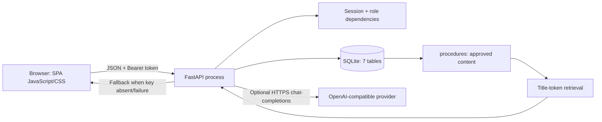
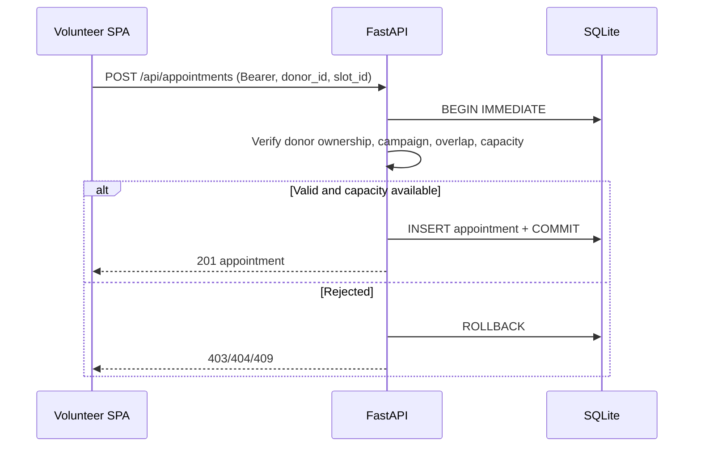

# Kiến trúc hiện tại

## Tổng quan

Đây là một ứng dụng FastAPI duy nhất, không có frontend build step. `GET /` trả `static/index.html`; `/static` phục vụ JS/CSS. Cùng process cung cấp API `/api/*` và SQLite. Mặc định DB nằm tại `data/blood_donation.db`, có thể thay bằng `BLOOD_DONATION_DB`.

## Thành phần và dữ liệu
- **SPA:** `static/app.js` dựng giao diện theo vai trò, lưu token/user trong `sessionStorage`, gửi bearer token và escape nội dung template qua `esc`; nội dung AI đưa vào `textContent`.
- **API:** `main.py` định nghĩa Pydantic input models, login/register, dependencies `signed_in`/`roles`, nghiệp vụ campaign/slots/appointments, thống kê, notification và assistant.
- **Persistence:** `connect()` bật SQLite foreign keys và WAL. Đặt chỗ dùng `BEGIN IMMEDIATE`, kiểm tra quyền sở hữu, trạng thái campaign, lịch trùng và sức chứa trước insert.
- **AI:** `ai_call()` là lời gọi outbound tùy chọn tới URL OpenAI-compatible, key/model/base URL cấu hình qua environment. `answer` truy xuất tối đa hai procedure dựa trên token trùng title; nếu không có nguồn phù hợp thì trả thông báo không tìm thấy. Khi không dùng được provider, dùng nội dung procedure. Không có embedding/vector store hoặc microservice RAG riêng.
- **Thông báo:** được ghi vào bảng `notifications`; không có tích hợp SMS/email.

## Luồng đặt lịch

## Giới hạn vận hành
Token session ở dictionary trong RAM, mất khi process restart và không chia sẻ giữa nhiều workers. SQLite phù hợp demo đơn tiến trình; WAL không thay thế backup/HA. API không cấu hình CORS middleware trong source hiện tại. Không dùng dữ liệu cá nhân/y tế thật trong demo.
