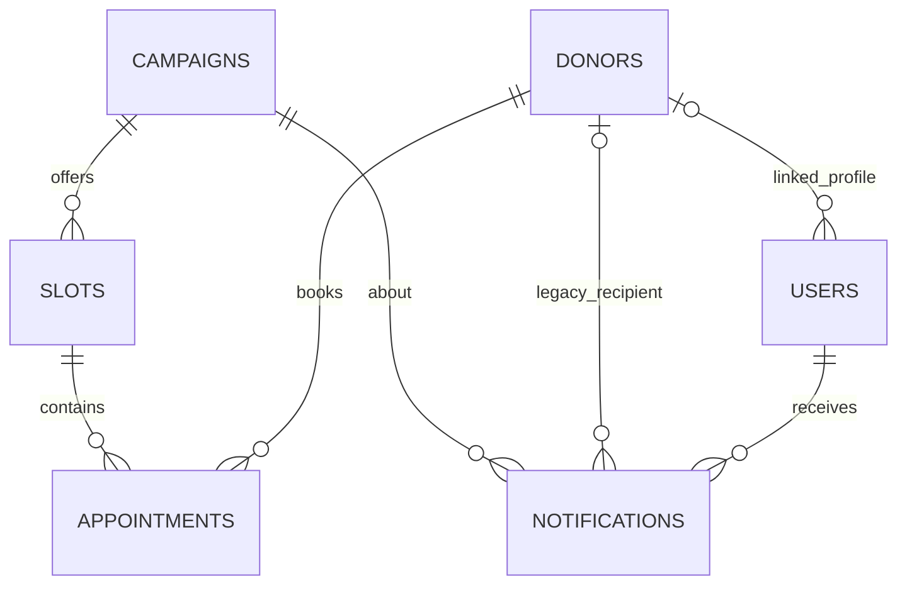

# Database Design

Nguồn đối chiếu: `initialize_database()` trong `main.py` và `data/blood_donation.db`. Schema SQL ở [schema.sql](../database/schema.sql) tái tạo DDL cho DB mới, không tự áp dụng đề xuất migration.

## Entity Relationship

`procedures` độc lập, lưu tiêu đề/nội dung hướng dẫn đã duyệt.

## Bảng hiện tại

| Bảng | Khóa và quan hệ | Ràng buộc hiện tại |
|---|---|---|
| `users` | PK `id`; nullable FK `donor_id -> donors.id` | `username UNIQUE`; thông tin email lưu ở username; phone/blood_group/address/organization/job_title có default, birth_date nullable để account không có donor vẫn lưu profile. |
| `donors` | PK `id` | `full_name`, `phone` NOT NULL; email/blood_group có default; created_at NOT NULL; birth_date nullable; address default empty. |
| `campaigns` | PK `id` | title, venue, date, start/end NOT NULL; status/description có default. |
| `slots` | PK `id`; nullable FK `campaign_id -> campaigns.id` | UNIQUE `(campaign_id,start_at)`; capacity không có CHECK. |
| `appointments` | PK `id`; FK donor và slot | UNIQUE `(donor_id,slot_id)`; status mặc định; không có CHECK/NOT NULL trên FK. |
| `notifications` | PK `id`; nullable FK user, appointment, donor và campaign | title/message/type/is_read/created_at; donor/campaign/sent_at giữ tương thích dữ liệu cũ. Nhắc reminder unique theo `(user_id,appointment_id)` qua partial index. |
| `procedures` | PK `id` | title/content nullable theo DDL hiện tại. |

Các FK dùng hành vi SQLite mặc định `ON DELETE NO ACTION`. 3 unique constraints tạo autoindex: username, campaign/start_at, donor/slot. Notification có index `(user_id,created_at DESC)` và partial unique index cho reminder theo appointment. `connect()` bật foreign key enforcement và WAL.

## Mối quan hệ
- Một campaign có nhiều slots; slot có nhiều appointments.
- Donor có thể liên kết user và có nhiều appointments/notifications.
- Campaign có notifications.
- `users.donor_id` không unique, nên DB hiện không đảm bảo một donor chỉ gắn một tài khoản.

## Migration và sai khác dữ liệu cũ
`initialize_database()` bổ sung `users.donor_id`, user/coordinator profile fields, `donors.created_at`, `donors.birth_date`, `donors.address` và các cột inbox notification cho DB legacy. Profile migration giữ nguyên hàng donor/user hiện có; notification cũ được backfill và không xóa/recreate dữ liệu. Trên DB legacy, các cột thêm mới có thể có default vật lý khác schema fresh-init.

## Khuyến nghị, chưa triển khai
- Cân nhắc NOT NULL và CHECK cho role/status/capacity, cùng unique `users.donor_id` nếu nghiệp vụ yêu cầu.
- Cân nhắc index cho `appointments(slot_id,status)`, `appointments(donor_id,status)`, `slots(campaign_id,start_at)` sau khi đo query plan. Unique hiện tại đã bao phủ prefix phù hợp một phần.
- Xác định chính sách cascade/restrict, backup, retention và migration; hiện thao tác xóa campaign tự kiểm tra lịch hẹn/thông báo.
